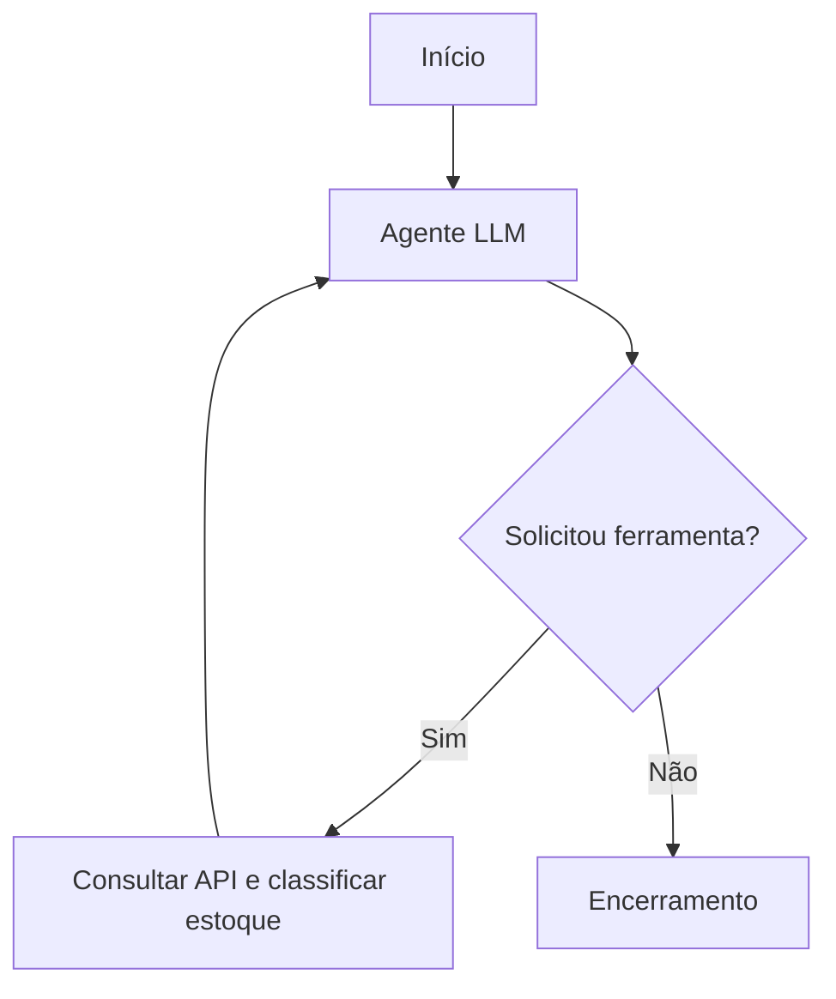

# Agente de Análise de Estoque

Projeto acadêmico individual do módulo Aperfeiçoar — Agentes de IA,
do SCTEC/SENAI, ministrado pelo professor Wanderson Souza.

**Autor:** Márcio Luiz

## Objetivo

Interpretar solicitações em linguagem natural, consultar produtos na API
de estoque disponibilizada pelo professor e apresentar uma análise
fundamentada na quantidade atual e no estoque mínimo.

Após uma consulta bem-sucedida, a aplicação pode enviar os dados da análise
a um workflow complementar no n8n.

## Tecnologias

- Python 3.11 e uv para gerenciamento do ambiente e das dependências.
- LangChain Core e integração OpenAI para o modelo e a ferramenta.
- LangGraph para estado compartilhado e controle do fluxo.
- HTTPX para comunicação HTTP.
- Pydantic para validação de entradas e respostas.
- n8n para recebimento e organização das análises.
- unittest para testes automatizados dos componentes.

## Arquitetura

1. O usuário informa uma pergunta pelo terminal.
2. O nó agente utiliza o LLM para interpretar a solicitação.
3. Uma transição condicional encaminha a execução à ferramenta,
   quando necessária, ou ao encerramento.
4. A ferramenta consulta a API, valida os dados e classifica o estoque.
5. O resultado retorna ao agente para elaboração da resposta.
6. Análises bem-sucedidas são enviadas ao n8n, quando configurado.

O estado utiliza MessagesState. O grafo possui os nós agente e ferramentas.
A execução pelo terminal possui limite de oito passos do LangGraph.

Perguntas conceituais podem ser respondidas sem ferramenta.
Cada execução começa sem memória de conversas anteriores.


### Fluxo do agente



A decisão condicional é implementada por `tools_condition`.
O nó de ferramentas utiliza `ToolNode`, e seu resultado retorna ao agente
como mensagem no estado compartilhado.

Após o encerramento do grafo, o programa principal apresenta a resposta
e envia as análises bem-sucedidas ao n8n, quando configurado.


## Regras de classificação

| Condição | Situação |
|---|---|
| Quantidade atual igual a zero | Esgotado |
| Quantidade positiva e menor ou igual ao mínimo | Baixo |
| Quantidade maior que o mínimo | Normal |

A igualdade com o mínimo é incluída em estoque baixo.
As comparações são realizadas em Python; o LLM explica o resultado.

## API de apoio

A API foi disponibilizada pelo professor e deve ser executada separadamente:

https://github.com/wangsouza/api-estoque

Este repositório contém a implementação do agente e suas integrações.
A aplicação utiliza consultas, sem cadastrar ou modificar produtos.

## Testes e evidências

Os cenários de execução, resultados observados e capturas estão em
[Validação do agente](docs/testes-agente.md).

O workflow exportado está em
[workflows/analise-estoque.json](workflows/analise-estoque.json).


## Requisitos

- Python 3.11, Git e uv.
- Chave de API da OpenAI com acesso ao modelo configurado.
- API de estoque do professor em execução para consultar produtos.
- n8n Cloud ou instalação local para demonstrar a automação complementar.

As chamadas ao LLM utilizam a API da OpenAI e podem gerar custos.
A chave deve ser configurada localmente e não deve ser versionada.

## Instalação do agente

Os exemplos abaixo utilizam o terminal PowerShell no Windows.

### 1. Obter o projeto

Na pasta em que deseja guardar o repositório:

```powershell
git clone https://github.com/MarcioLuizBR/sctec-agente-estoque.git
cd sctec-agente-estoque
```

### 2. Instalar as dependências

```powershell
uv sync --locked
.\.venv\Scripts\Activate.ps1
```

O uv utiliza a versão indicada em `.python-version` e instala as
dependências registradas em `uv.lock`, criando o ambiente `.venv`.

### 3. Configurar o ambiente

Na primeira instalação, copie o arquivo de exemplo:

```powershell
Copy-Item .env.example .env
```

Se já existir um `.env`, edite o arquivo existente para preservar
sua configuração.

Preencha no `.env`:

| Variável | Finalidade |
|---|---|
| `LLM_PROVIDER` | Provedor utilizado: `openai` |
| `OPENAI_API_KEY` | Sua chave de API da OpenAI |
| `OPENAI_MODEL` | Modelo utilizado: `gpt-4.1-mini` |
| `N8N_WEBHOOK_URL` | URL de produção do seu workflow n8n |

Deixe `N8N_WEBHOOK_URL` vazio para executar o agente sem enviar análises
ao n8n. Para reproduzir a integração completa, configure um workflow ativo.

O arquivo `.env` é ignorado pelo Git. O `.env.example` contém apenas
a configuração de referência, sem credenciais.


## Preparar e iniciar a API de estoque

Utilize um segundo terminal, separado do terminal do agente.

Na pasta em que guarda seus repositórios, obtenha a API do professor:

```powershell
git clone https://github.com/wangsouza/api-estoque.git
cd api-estoque
uv venv --python 3.11
.\.venv\Scripts\Activate.ps1
uv pip install -r requirements.txt
```

Se a API já estiver instalada, acesse sua pasta e ative seu ambiente,
sem repetir a clonagem e a instalação.

Inicie o servidor:

```powershell
python -m uvicorn app.main:app --reload --host 127.0.0.1 --port 8000
```

Mantenha esse terminal aberto durante as consultas.

- Verificação de disponibilidade: http://127.0.0.1:8000/health
- Documentação interativa: http://127.0.0.1:8000/docs

O cliente do agente utiliza o endereço `http://127.0.0.1:8000`.
Se alterar a porta da API, ajuste também `BASE_URL` em `api_client.py`.

## Executar o agente

No terminal do agente, dentro de `sctec-agente-estoque`, com seu
ambiente virtual ativo:

```powershell
python main.py
```

Digite uma pergunta quando solicitado. Exemplos:

- `Qual é a situação do estoque do produto PRD-001?`
- `Qual é a situação do estoque do produto PRD-999?`
- `O que significa estoque mínimo?`
- `Esse produto está acabando?`

O programa apresenta a quantidade de execuções de ferramenta,
seus retornos e a resposta final do agente.

Quando existe uma análise bem-sucedida, tenta enviá-la ao n8n.
Perguntas sem ferramenta e consultas com erro não geram eventos.
Cada execução recebe uma pergunta; execute novamente para outra consulta.

## Executar os testes automatizados

Na raiz do repositório, com o ambiente virtual do agente ativo:

```powershell
python -m unittest discover -s tests -v
```

Esses testes verificam timeout, JSON inválido, dados incompletos e
seis casos de classificação de estoque. Não exigem API ligada,
acesso à OpenAI ou conexão com o n8n.

Os testes manuais do agente completo estão documentados em
[docs/testes-agente.md](docs/testes-agente.md).


## Configurar a automação no n8n

### Finalidade

Receber análises produzidas pela aplicação Python e organizar os dados
em uma saída observável no histórico de execuções.

O workflow possui dois nós:

1. Webhook: recebe um POST com o evento `estoque.analisado`.
2. Edit Fields: seleciona evento, código, nome, quantidade atual,
   estoque mínimo, unidade e situação.

As decisões do LLM, o estado e a execução da ferramenta permanecem
no LangGraph. O n8n não executa outro agente.

### Importar e configurar

1. Acesse seu ambiente n8n Cloud ou local.
2. Crie um workflow e abra o menu de opções.
3. Selecione Import from File e escolha
   `workflows/analise-estoque.json`.
4. Confira o Webhook: método POST, caminho `analise-estoque`
   e resposta Immediately.
5. Publique ou ative o workflow, conforme a interface disponível.
6. Copie a Production URL exibida pelo nó Webhook.
7. Configure essa URL em `N8N_WEBHOOK_URL` no `.env` do agente.

A Test URL exige escuta manual por Listen for test event.
Para execução automática, utilize a Production URL com o workflow ativo.

### Verificar a integração

Execute o agente e consulte o produto PRD-001.

No terminal, confira o resultado do envio. No n8n, abra Executions,
selecione a nova execução e verifique a conclusão dos dois nós e
o OUTPUT do Edit Fields.

O HTTP de sucesso confirma o recebimento pelo Webhook.
A conclusão do workflow deve ser conferida no n8n.

O Python envia os dados ao n8n Cloud; o Cloud não precisa acessar
a API local de estoque. Não é necessário publicar essa API na internet.

## Limitações e controles

- Protótipo acadêmico com dados fictícios, sem implantação em produção.
- Consultas por código no formato PRD-XXX; não realiza cadastro,
  edição ou exclusão de produtos.
- Sem memória entre execuções independentes.
- A redação e a decisão de uso de ferramenta dependem do LLM.
  As instruções orientam seu comportamento, mas não garantem
  cumprimento em todas as entradas possíveis.
- Entradas e dados de produtos são validados com Pydantic.
- Falhas HTTP, de comunicação, timeout e respostas inválidas
  recebem tratamento no cliente da API.
- A execução do grafo possui limite de passos.
- A integração n8n é opcional e faz uma tentativa por envio,
  sem fila, reenvio automático ou garantia de entrega.
- Uma falha de envio ao n8n não remove a resposta já apresentada
  ao usuário.
- O Webhook demonstrado não utiliza autenticação e recebe somente
  dados fictícios. Autenticação seria necessária para ampliar
  o uso além deste ambiente demonstrativo.
- O ambiente n8n Cloud utilizado na demonstração depende de um trial.
  O JSON exportado permite recriar o workflow em outra instância,
  ajustando sua configuração.
- Credenciais ficam no `.env` local, ignorado pelo Git.

## Vídeo demonstrativo

Link: a inserir após a gravação.

A apresentação terá duração máxima de cinco minutos e demonstrará
o problema, o fluxo LangGraph, a ferramenta integrada à API,
a automação n8n e um cenário de erro ou limitação.