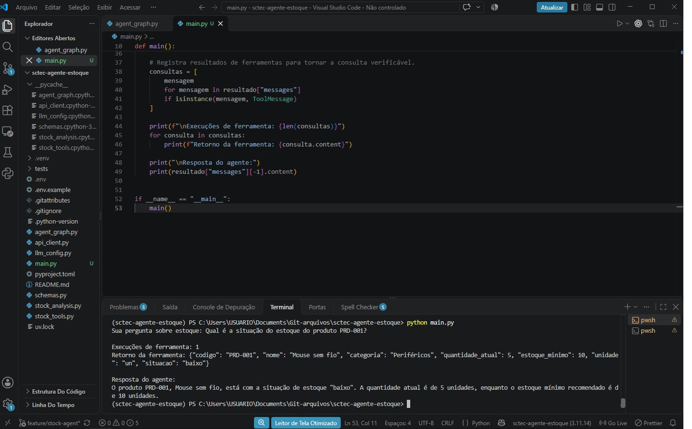
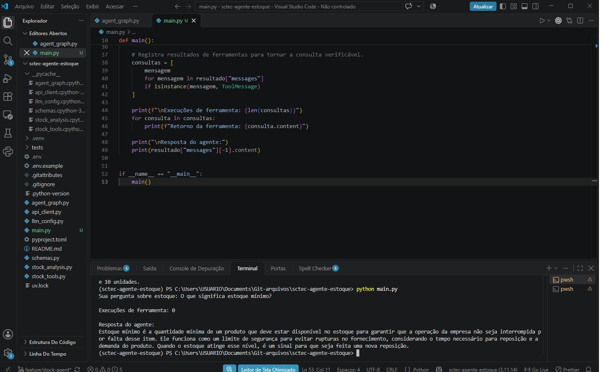
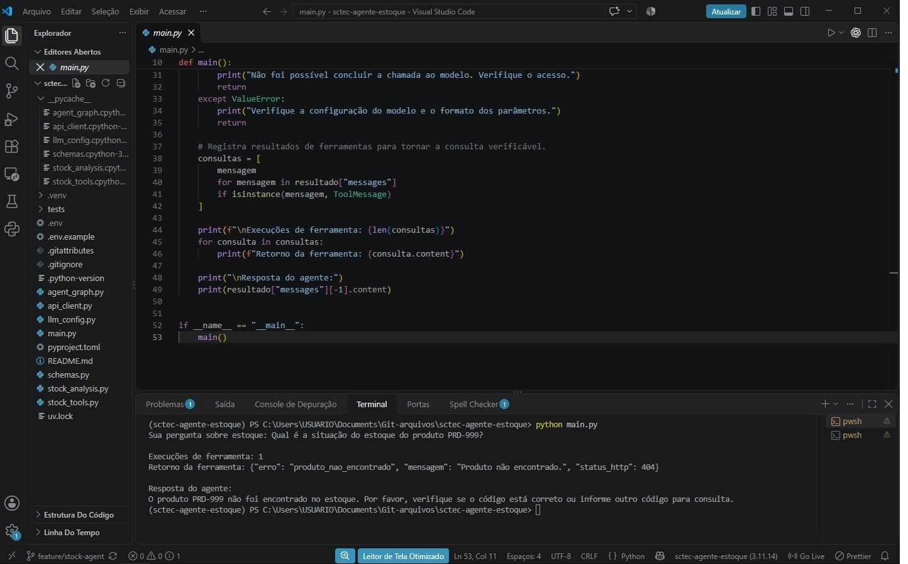
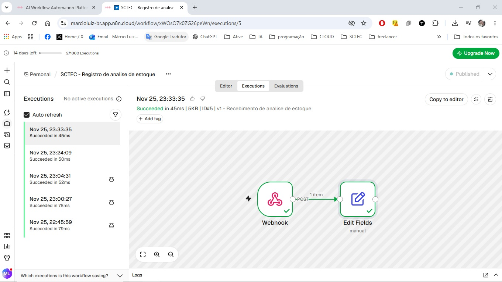

# Validação manual do agente de estoque

## Como reproduzir

1. Iniciar a API do professor na porta 8000.
2. Ativar o ambiente virtual do projeto.
3. Configurar o `.env` conforme `.env.example`, com uma chave válida.
4. Executar `python main.py` para cada cenário abaixo.

As chamadas ao modelo utilizam a API da OpenAI.
Cada execução começa sem histórico de conversas anteriores.
A redação das respostas pode variar; a avaliação considera os dados
apresentados e a decisão de utilizar ou não a ferramenta.

## Cenário 1 — Produto existente

- Entrada: `Qual é a situação do estoque do produto PRD-001?`
- Esperado: consultar a ferramenta e informar quantidade 5, mínimo 10
  e situação de estoque baixo.
- Observado: uma execução da ferramenta; dados e classificação
  apresentados corretamente na resposta.
- Evidência: captura `03-primeira-execucao-agente.png`.

## Cenário 2 — Produto inexistente

- Entrada: `Qual é a situação do estoque do produto PRD-999?`
- Esperado: consultar a ferramenta e informar que o produto não existe,
  sem inventar quantidade ou classificação.
- Observado: uma execução da ferramenta, erro `produto_nao_encontrado`,
  HTTP 404 e resposta orientando a verificar o código.
- Evidência: captura `05-agente-produto-inexistente.png`.

## Cenário 3 — Pergunta conceitual

- Entrada: `O que significa estoque mínimo?`
- Esperado: explicar o conceito sem consultar a ferramenta.
- Observado: zero execuções de ferramenta e explicação conceitual.
- Evidência: captura `04-agente-pergunta-conceitual.png`.

## Organização das evidências

As capturas dos três cenários obrigatórios e da execução do n8n estão
disponíveis na pasta `docs/evidencias` e apresentadas ao final deste documento.
As demais capturas mencionadas são materiais de apoio coletados para o vídeo.

## Cenário adicional — Solicitação ambígua

- Entrada: `Esse produto está acabando?`
- Esperado: solicitar o código do produto, sem executar a ferramenta
  nem inventar informações de estoque.
- Observado: zero execuções de ferramenta e solicitação de um código
  no formato PRD-XXX.
- Evidência: captura `06-agente-solicitacao-ambigua.png`.

## Integração complementar com n8n

O workflow recebe análises pelo Webhook e organiza os dados no Edit Fields.
O envio utiliza o resultado estruturado da ferramenta, sem nova consulta
à API e sem extrair informações da resposta textual do LLM.

### Análise bem-sucedida

- Entrada: `Qual é a situação do estoque do produto PRD-001?`
- Esperado: responder com os dados consultados e enviar a análise ao n8n.
- Observado: uma execução da ferramenta, estoque baixo, envio HTTP 200
  e execução ID 5 concluída como Succeeded no n8n.
- Evidências: `10-agente-integrado-n8n.png` e
  `11-workflow-executado-pelo-agente.png`.

### Caminhos sem envio

- Pergunta conceitual: zero execuções de ferramenta e nenhum envio.
- Produto PRD-999: ferramenta retornou HTTP 404 e nenhum envio.
- Após ambas as verificações, a execução mais recente do n8n permaneceu
  sendo a ID 5.

A confirmação HTTP do Webhook indica recebimento. A conclusão do
processamento foi conferida separadamente na aba Executions do n8n.

### Falha de comunicação com o n8n

- Procedimento: substituir N8N_WEBHOOK_URL apenas no processo de teste
  por http://127.0.0.1:1/webhook/analise-estoque.
- Entrada: `Qual é a situação do estoque do produto PRD-001?`
- Esperado: apresentar a análise e informar a falha do envio,
  sem interromper o programa.
- Observado: uma execução da ferramenta, resposta com quantidade 5,
  mínimo 10 e estoque baixo; envio retornou status `falhou`
  e motivo `falha_comunicacao`.
- Evidência: captura `12-agente-falha-n8n.png`.
- O arquivo .env não foi alterado pela simulação.

## Capturas disponíveis no repositório

### Produto existente

### Pergunta conceitual

### Produto inexistente

### Execução do workflow n8n

